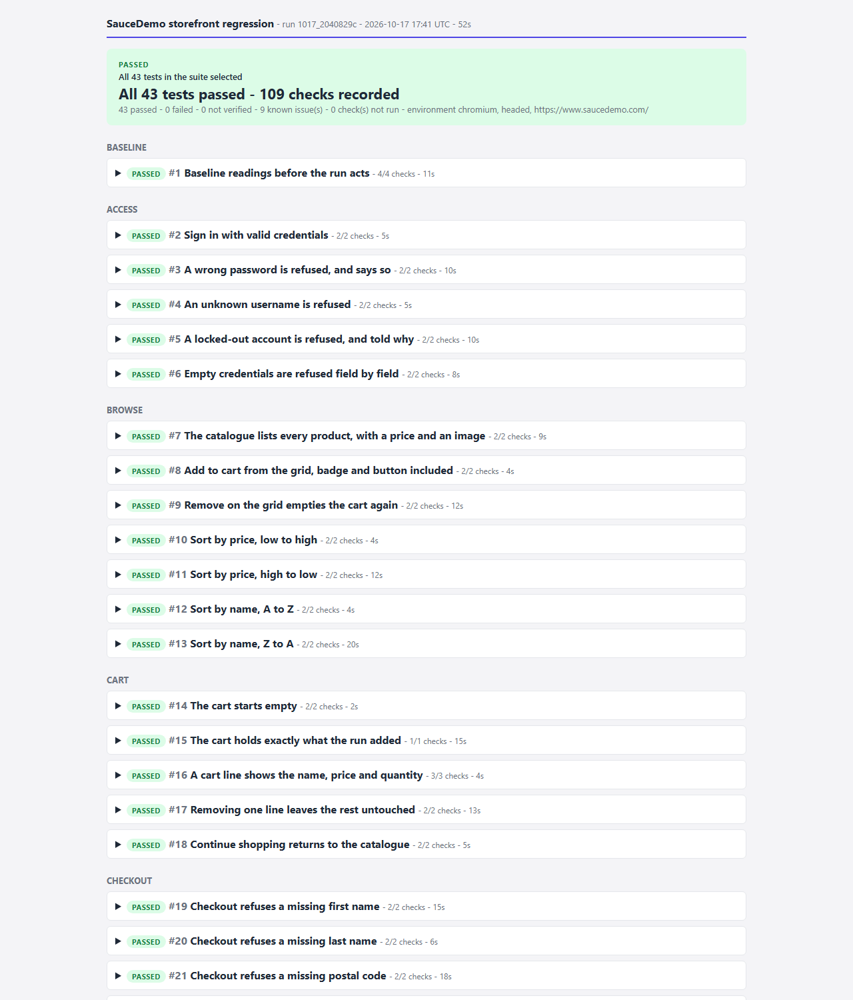
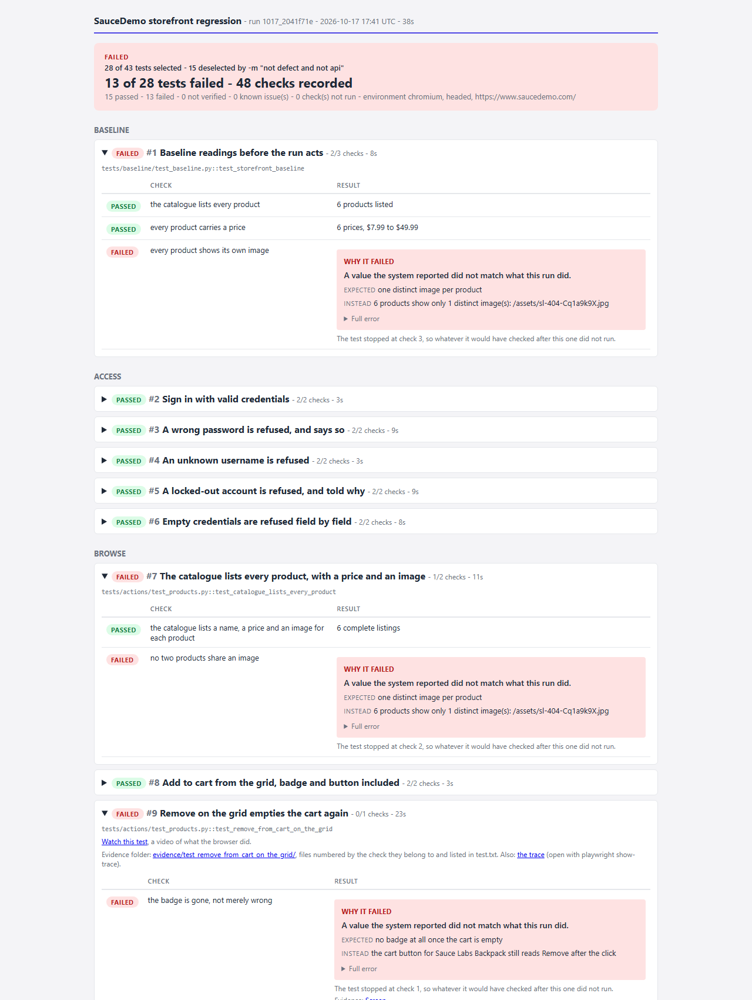
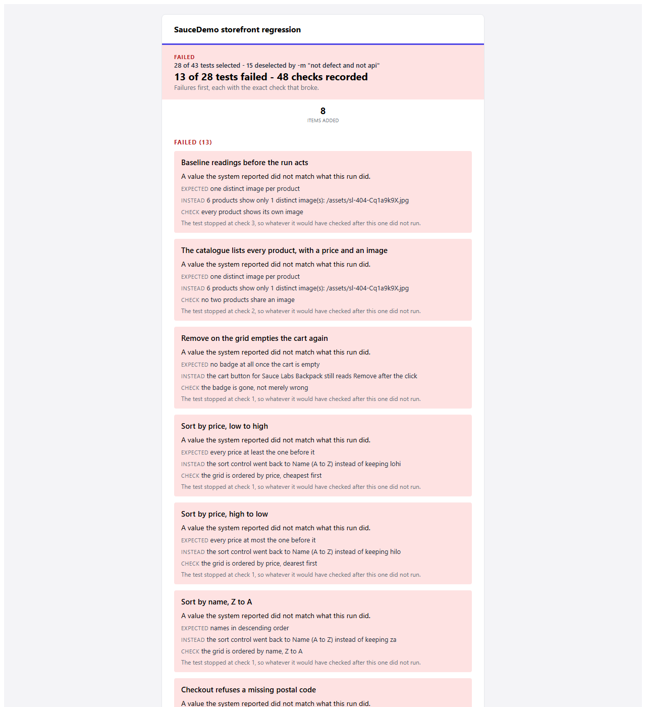
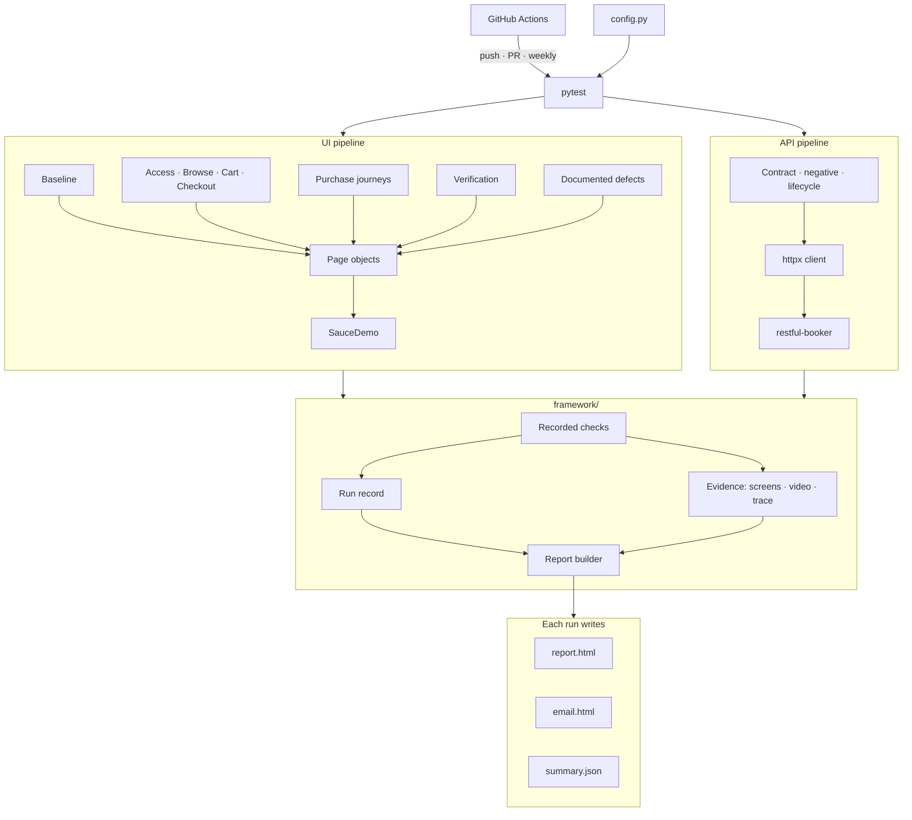

# E-Commerce Test Automation Framework

[](https://github.com/TheodorGit/playwright-test-framework/actions/workflows/tests.yml)


**Catches breaks in an e-commerce purchase funnel (login, browsing, cart, checkout, order totals and the backend API) on two browsers with every push. Every run writes a report built for the person reading it: each check says what it expected, what it found instead, and links the evidence. Includes [a defect log of 9 documented defects](BUGS.md) the suite pins in deliberately broken builds.**

Built with Python, Playwright and Pytest against public demo targets by design, so everything here is runnable by anyone: the [SauceDemo](https://www.saucedemo.com/) storefront for UI and the [restful-booker](https://restful-booker.herokuapp.com) API. Client work runs against your environments.

## What a report looks like

Every run writes its own folder: the full report, a one-page summary ready to send, machine-readable `summary.json`, and the evidence of anything that went wrong.

**A green run.** The verdict first, then every test in the order the run made them, grouped by stage. Known issues are the documented defects, still reproducing.



**A red run: the same suite, pointed at a deliberately broken build.** Each failed check says what it expected, what happened instead, and carries its screenshot, its video and its trace. It runs the UI lane, so the report opens with what that selected: 28 of 43 tests, and the expression that deselected the other 15. Each failed test says where it stopped, because the checks it would have made after that were never recorded.



**The one-page summary** (`email.html`), for whoever does not open the full report:



## What this demonstrates

| Capability | What it means for your project |
|---|---|
| **Recorded checks, not bare asserts** | Each check declares what it expected before it runs, so a failure reads as "expected the total to be $32.39, instead $29.99", not `assert 29.99 == 32.39` |
| **Reports a stakeholder can read** ([example](docs/images/report-green.png)) | Verdict, what the run was asked to run, stages, every check, and plain-language reasons. No stack trace needed to see what broke |
| **Defect reports in a fixed template** ([BUGS.md](BUGS.md), [docs/defects](docs/defects)) | Environment, preconditions, exact steps, actual against expected, evidence, cross-build verification, scope and impact. A developer can act on one without asking a question |
| **Documented defects pinned as known issues** | A defect that still reproduces is amber in the report and keeps the run green. A defect that is fixed fails its test, which is the signal to promote the check into the regression suite |
| **A positive control for every defect** | The same check runs on the sound build in the same run, which is what pins a defect to a build rather than to the storefront |
| **A verification stage** | The order total is recomputed from the prices the run itself read, and the API's list and detail views are compared against the booking the run created. Nothing passes by sitting inside a tolerance |
| **Evidence, numbered by check** | A failing or known-issue check leaves its own screenshot, and its test leaves a video of the browser and a Playwright trace, in a folder whose `test.txt` says which file answers which check |
| **Page Object Model** with stable `data-test` locators | UI changes are cheap to absorb: update one page class and every test that uses it keeps working |
| **Auto-retrying `expect()` assertions, zero `sleep()`** | Tests fail when the product is broken, not when the network is slow |
| **Log in once, reuse auth state** | Authenticated tests skip the login form via Playwright storage state, which leaves login behaviour to the tests that are about login |
| **Parallel execution** (pytest-xdist) | One flag (`-n auto`) spreads the suite across CPU cores, and every worker reports into the same run folder |
| **API test layer** (httpx + JSON Schema) | Backend contract breaks caught in seconds, without launching a browser |
| **GitHub Actions matrix** (Chromium + Firefox) | Cross-browser confidence on every push, with the whole run folder attached to each job and its verdict in the job summary |
| **Typed settings module**, all config via `.env` | Point the same suite at dev, staging or prod by changing an env file. No code edits, no hardcoded URLs or credentials |

## Architecture

Two targets, one framework: the UI stages run against SauceDemo, the API layer against restful-booker. Both record their checks through the same plugin, and one builder turns a run into its report.



## Quickstart

```bash
git clone https://github.com/TheodorGit/playwright-test-framework.git && cd playwright-test-framework
python -m venv .venv && source .venv/bin/activate    # Windows: .venv\Scripts\activate
pip install -r requirements.txt && playwright install chromium
```

```bash
pytest -n auto    # the whole suite, one worker per CPU core
```

Heads up: `-n auto` launches one browser instance per CPU core by design; that is the parallelism, not something going wrong. Each of them records a video and a trace, so on a small machine `-n 4` finishes about as fast and leaves the browsers room to breathe. Drop the flag to run tests one at a time. The virtual environment must be active whenever you run tests, so rerun the `activate` command from step 2 in every new terminal.

Defaults work out of the box (headless Chromium against SauceDemo). To customise, copy `.env.example` to `.env` and edit. Target URL, credentials, browser and headless mode are all environment-driven via `config.py`.

Each run prints where its report landed:

```
[report] [PASSED] SauceDemo storefront regression: all 43 tests passed - 100 of 109 recorded checks passed (9 known issue(s)) - 2026-10-17 17:41 UTC
[report] test_results/run_1017_2040829c/report.html
[report] latest: test_results/latest.html
```

`test_results/latest.html` always opens the newest run, so it can stay open in a browser tab while you work.

## Running the suites

```bash
pytest -n auto                        # the whole suite, parallelised
pytest tests/actions                  # one action at a time: access, browse, cart, checkout
pytest tests/e2e                      # complete purchase journeys
pytest tests/verification             # recomputes the money, compares the API to itself
pytest -m api                         # the API layer, wherever it lives, no browser
pytest -m defect                      # the 9 documented defects, against the broken builds
pytest -m "not api and not defect"    # everything the UI job runs in CI
pytest framework/tests                # the framework's own unit tests, no browser
BROWSER=firefox pytest tests/e2e      # same tests, different engine
```

Pointing the regression suite at a broken build is one environment variable, and is how the red report above was produced:

```bash
TEST_USERNAME=problem_user pytest -m "not defect and not api" -n auto
```

| Variable | What it does |
|---|---|
| `QA_RUN_LABEL` | Names the run, so its folder is `run_<id>-<label>` |
| `QA_KEEP_VIDEOS=all` | Keeps a video of every browser test, not only of the ones that failed |
| `QA_RESULTS_DIR` | Writes runs somewhere other than `test_results/` |

## Project structure

```
├── .github/
│   ├── scripts/ci_summary.py     # Job summary, built from the run's own summary.json
│   └── workflows/tests.yml       # CI: Chromium + Firefox matrix, defect scan, API job
├── BUGS.md                       # Defect log: the index, and how each report is written
├── config.py                     # Typed, frozen settings and the only place env vars are read
├── docs/defects/                 # One report per defect, with the evidence the run captured
├── framework/                    # The reporting framework
│   ├── defects.py                # The defect catalogue the tests and the report share
│   ├── manifest.py               # What ran and how each test ended, written as it happens
│   ├── pytest_plugin.py          # The pytest plugin: run folder, checks fixture, report
│   ├── tokens.py                 # The run's identity and its folder
│   ├── ui.py                     # Videos, traces and the screens of each check
│   ├── tests/                    # The framework's own unit tests (no browser)
│   └── reporting/
│       ├── evidence.py           # Evidence folders, numbered by the check they belong to
│       ├── failure_reasons.py    # Plain-language reasons, so a report needs no stack trace
│       ├── profiles.py           # The seam a suite registers its stages and titles through
│       ├── recorder.py           # Recorded checks, known defects included
│       └── report_builder.py     # report.html, email.html and summary.json
├── pages/                        # Page Object Model (BasePage + 4 page classes)
├── tests/
│   ├── conftest.py               # Browser lifecycle, auth reuse, evidence, API client
│   ├── profile.py                # This suite's stages, titles and order, as the report shows them
│   ├── shop.py                   # The shop arithmetic the verification stage checks against
│   ├── baseline/                 # Readings taken before the run acts on anything
│   ├── actions/                  # One action at a time: access, browse, cart, checkout
│   ├── e2e/                      # Complete purchase journeys
│   ├── api/                      # Contract, negative and lifecycle tests (httpx + JSON Schema)
│   ├── verification/             # Order totals and API agreement, checked against the run
│   └── defects/                  # The documented defects, pinned as known issues
└── pyproject.toml                # pytest config and markers, and the ruff rules
```

## This repo and its sibling

Two repos, two jobs. This one is where defect reporting lives: real defects in
public builds, each written up in the field template under
[`docs/defects/`](docs/defects) with a `DEF-NN` id, a severity and a check that
pins it. [saas-e2e-reference-architecture](https://github.com/TheodorGit/saas-e2e-reference-architecture)
carries no defect reports on purpose: its defects are switches in its own
example app, so what it documents is the pattern that catches each class of
them, in its case studies and its bug matrix. One shows how a defect is written
up for a developer, the other how a suite is built to find it in the first
place. The reporting framework here is a scaled-down port of the one there.

## About me

**Theodor, QA Automation Engineer.** Python · Playwright · Pytest · Jenkins · SQL.
UI and API automation, and the reporting around it: defect reports a developer can act on, and runs that say what they checked.

Find me on GitHub: [@TheodorGit](https://github.com/TheodorGit)
