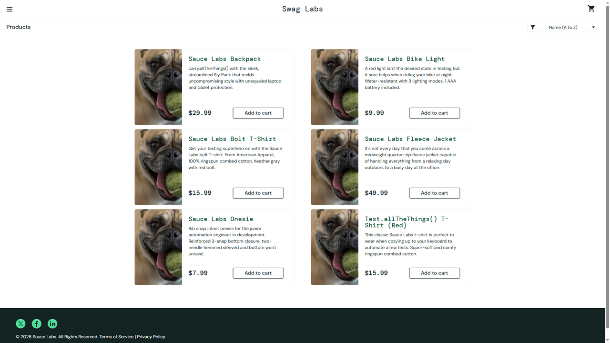

# DEF-01: every product shows the same broken image

| Field | Entry |
|---|---|
| **Title** | SauceDemo, problem_user build - every product on the catalogue shows the same broken image |
| **Source URL** | <https://www.saucedemo.com/inventory.html> |
| **Version in which the defect was initially detected** | SauceDemo publishes no build number. The defect belongs to the build served to `problem_user`; this suite first recorded it on 2026-10-17, run `1017_1337f860`. |
| **Source / Owner** | QA. Found by the regression suite, pointed at the `problem_user` build. |
| **Browsers / Devices** | Chromium 143 and Firefox 144, desktop at 1920x1080. Served by the build, not rendered by the browser: both engines receive the same source. |
| **User role** | Customer, signed in as `problem_user`. |
| **Affected versions** | Every build served to `problem_user` since this suite began checking. Not reproducible on the standard build of the same deploy. |
| **Severity** | Major. Customers cannot see what they are buying. |
| **Status** | Open. Pinned by an automated check on every run. |

## Full defect description

The catalogue renders all six products with one and the same image, the
placeholder the store returns for a missing asset. Names and prices are
correct, so the page looks complete at a glance while no product can be told
apart by sight.

## Preconditions

An account served the `problem_user` build, and a catalogue holding more than
one product.

## Steps to reproduce and related screenshots

1. Open <https://www.saucedemo.com/> and sign in as `problem_user`.
2. Look at the product grid on the inventory page.
3. Read the `src` of each product image.

## Actual results

All six products carry the same image source, `/assets/sl-404-Cq1a9k9X.jpg`,
which is the asset the store serves when an image is missing. Six products,
one image.

## Expected results

Each product shows its own photograph: six products, six distinct image
sources, as the standard build returns.

## Movie / console logs / network requests

All six `img` elements request the same asset. The run records the sources it
read in the check itself, and the screenshot above is taken at the moment the
check failed.

## Defect verification on other builds and estimations

In the same run, the same check passes on the standard build, which returns six
distinct sources. The defect belongs to the build served to `problem_user`,
not to the catalogue page.

## Scope and impact

Every customer served this build, on every product in the catalogue. Browsing
by sight is impossible, and a storefront of placeholder images costs trust long
before the cart is reached.

## Advanced info

Pinned by `tests/defects/test_known_defects.py::test_each_product_shows_its_own_image`,
check "every product shows its own image". The regression suite catches it from
the other side: the baseline reading and `test_catalogue_lists_every_product`
both fail when the suite is pointed at this build.

## Notes

The placeholder is the store's own 404 asset, so the images are not slow to
load: the build points every product at the missing-asset file.
