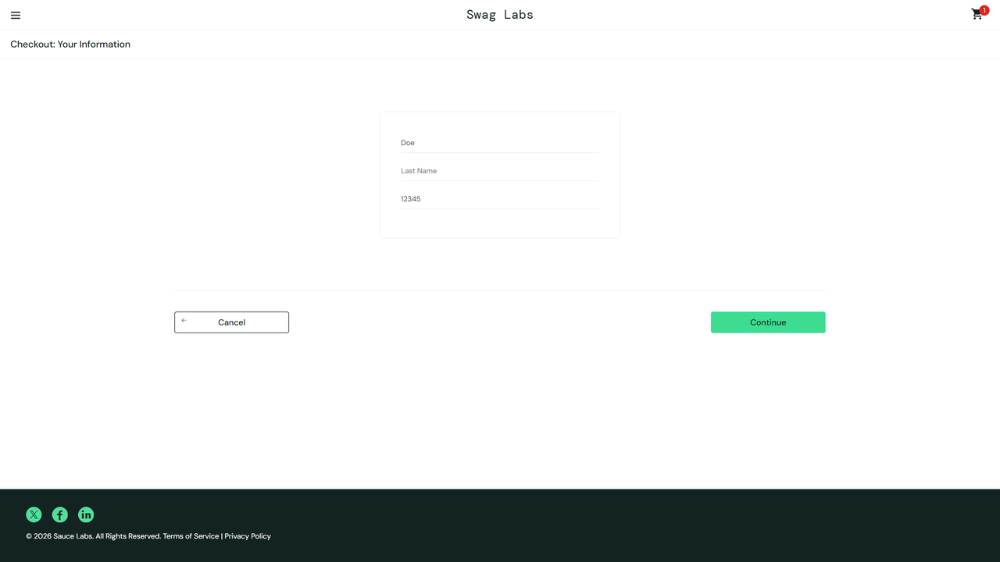

# DEF-03: the Last Name input writes into the First Name field

| Field | Entry |
|---|---|
| **Title** | SauceDemo, problem_user build - checkout step one writes the last name into the first name field |
| **Source URL** | <https://www.saucedemo.com/checkout-step-one.html> |
| **Version in which the defect was initially detected** | SauceDemo publishes no build number. The defect belongs to the build served to `problem_user`; this suite first recorded it on 2026-10-17, run `1017_1337f860`. |
| **Source / Owner** | QA. Found by the regression suite, pointed at the `problem_user` build. |
| **Browsers / Devices** | Chromium 143 and Firefox 144, desktop at 1920x1080. |
| **User role** | Customer, signed in as `problem_user`. |
| **Affected versions** | Every build served to `problem_user` since this suite began checking. Not reproducible on the standard build of the same deploy. |
| **Severity** | Critical. The purchase funnel cannot be completed with correct customer data. |
| **Status** | Open. Pinned by an automated check on every run. |

## Full defect description

On checkout step one, what is typed into **Last Name** lands in **First Name**.
The last name field stays empty and the first name ends up holding the last
name, so no order can carry the customer's real name.

## Preconditions

An account served the `problem_user` build, with at least one item in the cart,
on checkout step one.

## Steps to reproduce and related screenshots

1. Sign in as `problem_user`, add any product to the cart and open the cart.
2. Click **Checkout**.
3. Type `John` into **First Name**.
4. Type `Doe` into **Last Name**.

## Actual results

First Name holds `Doe` and Last Name holds nothing: the first name typed in
step 3 is overwritten by the last name typed in step 4.

## Expected results

First Name holds `John` and Last Name holds `Doe`, each field keeping what was
typed into it.

## Movie / console logs / network requests

The run reads both field values straight after typing and records them in the
check. The screenshot above is the form at that moment.

## Defect verification on other builds and estimations

In the same run, the same form on the standard build keeps `John` and `Doe`
apart. The defect belongs to the build served to `problem_user`.

## Scope and impact

Every customer served this build who reaches checkout. Orders can only be
placed with a wrong or missing name, which carries into fulfilment and into any
record of the sale.

It also masks the form's own validation: with the last name left empty,
checkout answers "Last Name is required" to a customer who did fill the form,
and the postal code rule is never reached.

## Advanced info

Pinned by `tests/defects/test_known_defects.py::test_checkout_keeps_first_and_last_name_apart`,
check "the form keeps the first and last name apart". The masking is visible in
the regression run against this build, where `test_checkout_requires_a_postal_code`
fails with the last-name message instead of the postal-code one.

## Notes

The `error_user` build breaks the same field differently: there it accepts no
input at all ([DEF-08](DEF-08-last-name-accepts-no-input.md)).
