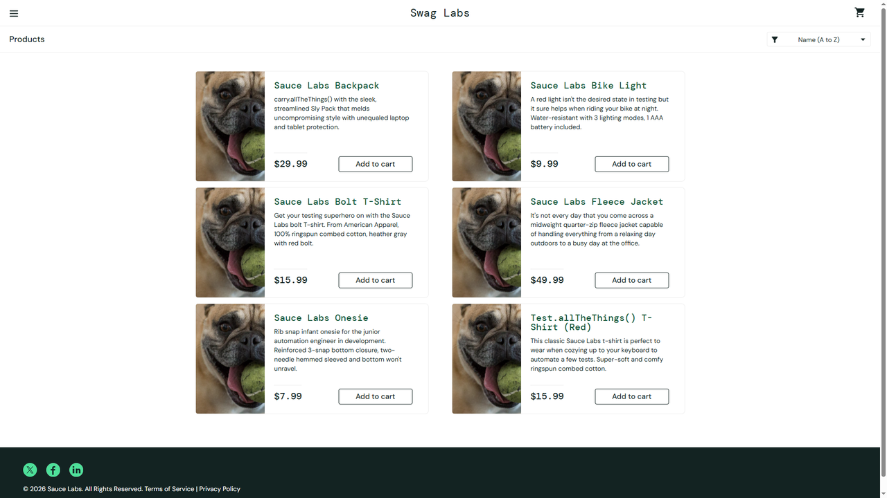

# DEF-04: Add to cart is unresponsive for some products

| Field | Entry |
|---|---|
| **Title** | SauceDemo, problem_user build - Add to cart does nothing for some products, with no error |
| **Source URL** | <https://www.saucedemo.com/inventory.html> |
| **Version in which the defect was initially detected** | SauceDemo publishes no build number. The defect belongs to the build served to `problem_user`; this suite first recorded it on 2026-10-17, run `1017_1337f860`. |
| **Source / Owner** | QA. Found by the regression suite, pointed at the `problem_user` build. |
| **Browsers / Devices** | Chromium 143 and Firefox 144, desktop at 1920x1080. |
| **User role** | Customer, signed in as `problem_user`. |
| **Affected versions** | Every build served to `problem_user` since this suite began checking. Not reproducible on the standard build of the same deploy. |
| **Severity** | Critical. Revenue is lost directly on the affected products. |
| **Status** | Open. Pinned by an automated check on every run. |

## Full defect description

For some products the **Add to cart** button does nothing at all: no cart
badge, no change of button, no error. Other products on the same page add
normally, so the page gives every impression of working.

## Preconditions

An account served the `problem_user` build, with an empty cart.

## Steps to reproduce and related screenshots

1. Open <https://www.saucedemo.com/> and sign in as `problem_user`.
2. Click **Add to cart** on *Sauce Labs Bolt T-Shirt*.
3. Look at the cart badge and at the button.
4. Click **Add to cart** on *Sauce Labs Backpack* for comparison.

## Actual results

After step 2 there is no cart badge and the button still reads `Add to cart`.
After step 4 the badge appears and reads `1`, counting the backpack alone: the
shirt never entered the cart.

The same happens on *Sauce Labs Fleece Jacket*. A regression run against this
build ends with a cart holding `Sauce Labs Backpack` and `Sauce Labs Bike
Light` while the run added a Fleece Jacket as well.

## Expected results

Every product adds to the cart: the badge counts it and the button changes to
**Remove**, as the standard build does for all six products.

## Movie / console logs / network requests

No error is raised and no request fails: the click produces nothing. The run
records the badge count and the button label it read after the click, and keeps
a video of the attempt.

## Defect verification on other builds and estimations

In the same run, the same product adds normally on the standard build, and
another product adds on this same broken build. The defect is therefore tied
to the build and to particular products, not to the Add to cart feature as a
whole.

## Scope and impact

Every customer served this build, on at least *Sauce Labs Bolt T-Shirt* and
*Sauce Labs Fleece Jacket*. Those products cannot be bought at all, and the
customer is given no reason why, so the loss is invisible on the storefront
side.

## Advanced info

Pinned by `tests/defects/test_known_defects.py::test_every_product_can_be_added_to_the_cart`,
check "adding Sauce Labs Bolt T-Shirt reaches the cart". The same test adds a
working product straight afterwards, which is what narrows the defect to
specific products.

## Notes

The same build also ignores **Remove** on the grid
([DEF-05](DEF-05-grid-remove-unresponsive.md)). Both point at the same part of
the page, so they are worth investigating together.
