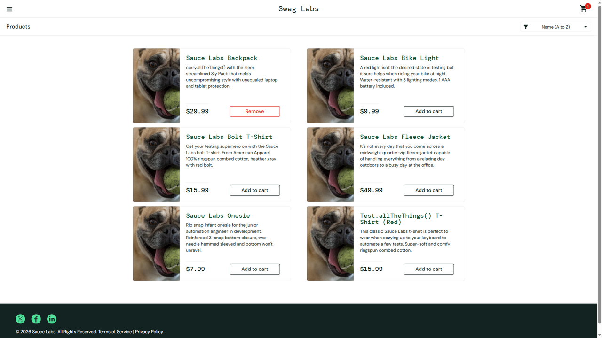

# DEF-05: Remove on the product grid leaves the cart unchanged

| Field | Entry |
|---|---|
| **Title** | SauceDemo, problem_user build - Remove on the product grid does not take the item out of the cart |
| **Source URL** | <https://www.saucedemo.com/inventory.html> |
| **Version in which the defect was initially detected** | SauceDemo publishes no build number. The defect belongs to the build served to `problem_user`; this suite first recorded it on 2026-10-17, run `1017_1337f860`. |
| **Source / Owner** | QA. Found by the regression suite, pointed at the `problem_user` build. |
| **Browsers / Devices** | Chromium 143 and Firefox 144, desktop at 1920x1080. |
| **User role** | Customer, signed in as `problem_user`. |
| **Affected versions** | Every build served to `problem_user` since this suite began checking. Not reproducible on the standard build of the same deploy. |
| **Severity** | Major. Customers cannot undo an add from the page they added it on. |
| **Status** | Open. Pinned by an automated check on every run. |

## Full defect description

On the product grid, a product that was added to the cart offers **Remove**,
but clicking it changes nothing: the cart badge keeps its count and the button
keeps reading Remove. The customer has to open the cart page to take the item
out.

## Preconditions

An account served the `problem_user` build, and a product that can be added
(see [DEF-04](DEF-04-add-to-cart-unresponsive.md): some cannot).

## Steps to reproduce and related screenshots

1. Open <https://www.saucedemo.com/> and sign in as `problem_user`.
2. Click **Add to cart** on *Sauce Labs Backpack*. The badge reads `1` and the
   button changes to **Remove**.
3. Click **Remove** on the same product.
4. Look at the cart badge and at the button.

## Actual results

The cart badge still reads `1` and the button still reads `Remove`. Nothing
about the click reaches the cart.

## Expected results

The item leaves the cart: the badge disappears and the button returns to
**Add to cart**, as the standard build does.

## Movie / console logs / network requests

No error is raised. The run records the badge count and the button label after
the click, and keeps a video of the attempt.

## Defect verification on other builds and estimations

In the same run, add and remove both work on the standard build: the badge
disappears and the button returns to Add to cart. The defect belongs to the
build served to `problem_user`.

## Scope and impact

Every customer served this build. An item added by mistake cannot be undone
where it was added, which pushes unwanted items into checkout for anyone who
does not find the cart page.

## Advanced info

Pinned by `tests/defects/test_known_defects.py::test_remove_on_the_grid_updates_the_cart`,
check "Remove on the grid empties the cart". The test first proves the item is
in the cart, so a failure cannot be mistaken for an item that was never added.

## Notes

Reported separately from [DEF-04](DEF-04-add-to-cart-unresponsive.md) because
the symptoms differ, although both affect the cart buttons on the grid and may
share a cause.
