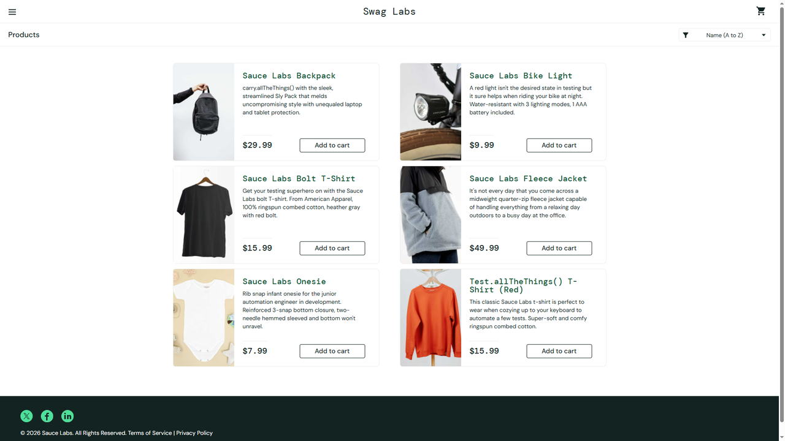

# DEF-06: sorting raises an error dialog and does not sort

| Field | Entry |
|---|---|
| **Title** | SauceDemo, error_user build - sorting the catalogue raises an error dialog and leaves the order untouched |
| **Source URL** | <https://www.saucedemo.com/inventory.html> |
| **Version in which the defect was initially detected** | SauceDemo publishes no build number. The defect belongs to the build served to `error_user`; this suite first recorded it on 2026-10-17, run `1017_1337f860`. |
| **Source / Owner** | QA. Found by the regression suite, pointed at the `error_user` build. |
| **Browsers / Devices** | Chromium 143 and Firefox 144, desktop at 1920x1080. |
| **User role** | Customer, signed in as `error_user`. |
| **Affected versions** | Every build served to `error_user` since this suite began checking. Not reproducible on the standard build of the same deploy. |
| **Severity** | Major. The feature is broken and the failure is thrown at the customer. |
| **Status** | Open. Pinned by an automated check on every run. |

## Full defect description

Choosing any sort option raises a browser dialog reading "Sorting is broken!
This error has been reported to Backtrace." The dialog has to be dismissed, and
the grid keeps its original order afterwards.

## Preconditions

An account served the `error_user` build, and a catalogue of several products.

## Steps to reproduce and related screenshots

1. Open <https://www.saucedemo.com/> and sign in as `error_user`.
2. Choose **Price (low to high)** in the sort dropdown.
3. Read the dialog, dismiss it, and read the prices from left to right.

## Actual results

A browser dialog appears with the text:

> Sorting is broken! This error has been reported to Backtrace.

After dismissing it the grid is unchanged: `$29.99, $9.99, $15.99, $49.99,
$7.99, $15.99`.

## Expected results

The grid reorders by price and no dialog is shown. Any failure the store
reports to itself is not the customer's to dismiss.

## Movie / console logs / network requests

The dialog text is captured by the run and kept as
[`evidence/DEF-06-dialog.txt`](evidence/DEF-06-dialog.txt): a browser dialog
cannot appear in a screenshot, so the run records its message instead. The run
also keeps a video of the attempt.

## Defect verification on other builds and estimations

In the same run, the same sort is quiet and correct on the standard build,
returning `$7.99` first and `$49.99` last. The defect belongs to the build
served to `error_user`.

## Scope and impact

Every customer served this build, on all four sort options. The customer is
shown an internal error message and still cannot sort, and the dialog blocks
the page until it is dismissed.

## Advanced info

Pinned by `tests/defects/test_known_defects.py::test_sorting_completes_without_an_error_dialog`,
check "sorting completes without an error dialog". The test registers a dialog
handler, so the message is recorded as evidence instead of being dismissed
unseen, which is what an automated run would otherwise do.

## Notes

The `problem_user` build fails the same feature without the dialog, which is
[DEF-02](DEF-02-price-sort-ignored.md). The message names Backtrace, so the
store is reporting this to its own error tracker: the receiving end should
already hold occurrences of it.
