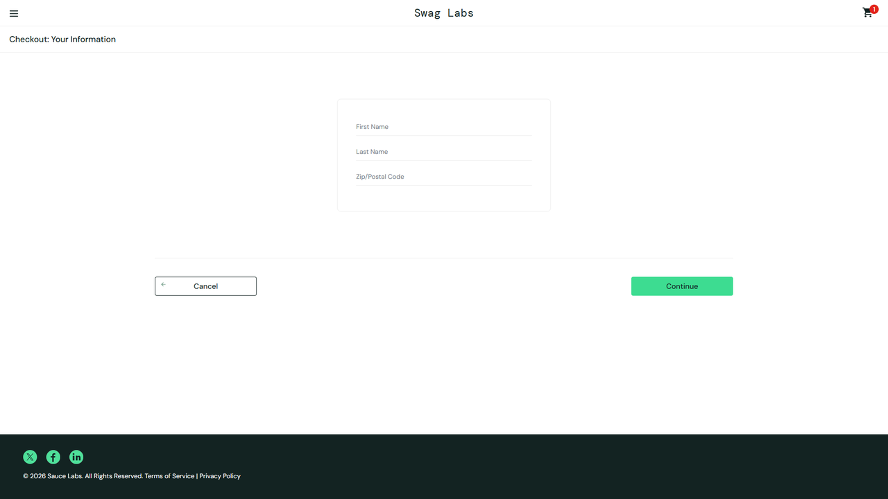

# DEF-08: the Last Name field accepts no input

| Field | Entry |
|---|---|
| **Title** | SauceDemo, error_user build - the Last Name field on checkout step one keeps nothing that is typed into it |
| **Source URL** | <https://www.saucedemo.com/checkout-step-one.html> |
| **Version in which the defect was initially detected** | SauceDemo publishes no build number. The defect belongs to the build served to `error_user`; this suite first recorded it on 2026-10-17, run `1017_1337f860`. |
| **Source / Owner** | QA. Found by the regression suite, pointed at the `error_user` build. |
| **Browsers / Devices** | Chromium 143 and Firefox 144, desktop at 1920x1080. |
| **User role** | Customer, signed in as `error_user`. |
| **Affected versions** | Every build served to `error_user` since this suite began checking. Not reproducible on the standard build of the same deploy. |
| **Severity** | Critical. A required field cannot be filled, so no order can carry a complete name. |
| **Status** | Open. Pinned by an automated check on every run. |

## Full defect description

On checkout step one, the **Last Name** field keeps nothing. Typing into it
leaves the field empty, while the other two fields on the same form keep what
is typed into them.

## Preconditions

An account served the `error_user` build, with at least one item in the cart,
on checkout step one.

## Steps to reproduce and related screenshots

1. Sign in as `error_user`, add any product to the cart and open the cart.
2. Click **Checkout**.
3. Type `Doe` into **Last Name**, then read the field back.
4. Type `John` into **First Name** for comparison, and read that field back.

## Actual results

**Last Name** holds nothing after `Doe` is typed into it. **First Name** holds
`John`, so the form is not inert as a whole, only this field.

The field carries neither a `readonly` nor a `disabled` attribute, so it looks
editable and behaves as though it is: the value is dropped rather than refused.

## Expected results

**Last Name** holds `Doe`, like any other text field on the form.

## Movie / console logs / network requests

The run reads the field value back straight after typing and records what it
found, and checks `readonly` and `disabled` to separate "not editable" from
"accepts the input and discards it". A video and a trace of the attempt are
kept with the run.

## Defect verification on other builds and estimations

In the same run, the same field keeps `Doe` on the standard build. The defect
belongs to the build served to `error_user`.

## Scope and impact

Every customer served this build who reaches checkout. No order from this build
can carry a last name, which affects delivery, invoicing and every downstream
record of the customer.

## Advanced info

Pinned by `tests/defects/test_known_defects.py::test_the_last_name_field_accepts_input`,
check "the Last Name field keeps what is typed into it". The test also types
into First Name on the same build, which is what narrows the defect to one
field instead of to the form.

## Notes

The validation that should stop an order without a last name is itself broken
on this build ([DEF-09](DEF-09-empty-last-name-accepted.md)), so this defect is
not visible to the customer: the order simply moves on without a name. The
`problem_user` build breaks the same field in the opposite direction
([DEF-03](DEF-03-last-name-writes-first-name.md)).
