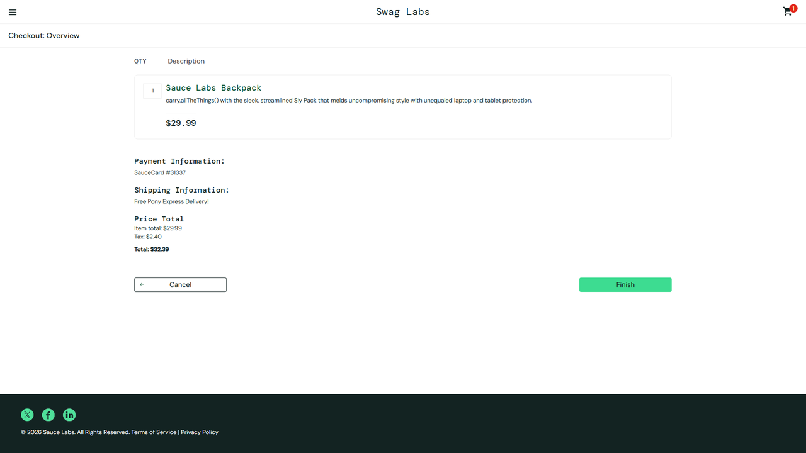

# DEF-09: checkout continues with an empty Last Name

| Field | Entry |
|---|---|
| **Title** | SauceDemo, error_user build - checkout step one accepts an order with no last name |
| **Source URL** | <https://www.saucedemo.com/checkout-step-one.html> |
| **Version in which the defect was initially detected** | SauceDemo publishes no build number. The defect belongs to the build served to `error_user`; this suite first recorded it on 2026-10-17, run `1017_1337f860`. |
| **Source / Owner** | QA. Found by the regression suite, pointed at the `error_user` build. |
| **Browsers / Devices** | Chromium 143 and Firefox 144, desktop at 1920x1080. |
| **User role** | Customer, signed in as `error_user`. |
| **Affected versions** | Every build served to `error_user` since this suite began checking. Not reproducible on the standard build of the same deploy. |
| **Severity** | Major. A required field is not enforced, and incomplete orders pass into the funnel. |
| **Status** | Open. Pinned by an automated check on every run. |

## Full defect description

Checkout step one lets an order through with **Last Name** empty. The customer
reaches the order overview with no last name on the order and without being
told anything is missing.

## Preconditions

An account served the `error_user` build, with at least one item in the cart,
on checkout step one.

## Steps to reproduce and related screenshots

1. Sign in as `error_user`, add any product to the cart and open the cart.
2. Click **Checkout**.
3. Fill **First Name** and **Postal Code**, and leave **Last Name** empty.
4. Click **Continue**.

## Actual results

The browser moves to `checkout-step-two.html`, the order overview. No error
message appears on step one.

## Expected results

Step one refuses the order and shows "Last Name is required", as the standard
build does, and the customer stays on step one.

## Movie / console logs / network requests

The run records the page reached after Continue and the error element it looked
for, and keeps a video and a trace of the attempt. The overview never shows the
customer's name, so the screenshot evidences the page that was reached; the empty
field is what the steps above set and what the check recorded.

## Defect verification on other builds and estimations

In the same run, the standard build refuses the same order with "Last Name is
required". The defect belongs to the build served to `error_user`.

## Scope and impact

Every customer served this build. Orders can enter the funnel without a last
name, so fulfilment and invoicing receive incomplete customer records with
nothing marking them as incomplete.

## Advanced info

Pinned by `tests/defects/test_known_defects.py::test_checkout_refuses_an_empty_last_name`,
check "checkout refuses an order with no last name".

## Notes

Found while reporting [DEF-08](DEF-08-last-name-accepts-no-input.md): the field
that takes no input would have been caught by this validation, and is not. The
two defects mask each other, which is why they are filed separately. Fixing
only the validation would leave customers on this build unable to check out at
all, since the field still keeps nothing.
